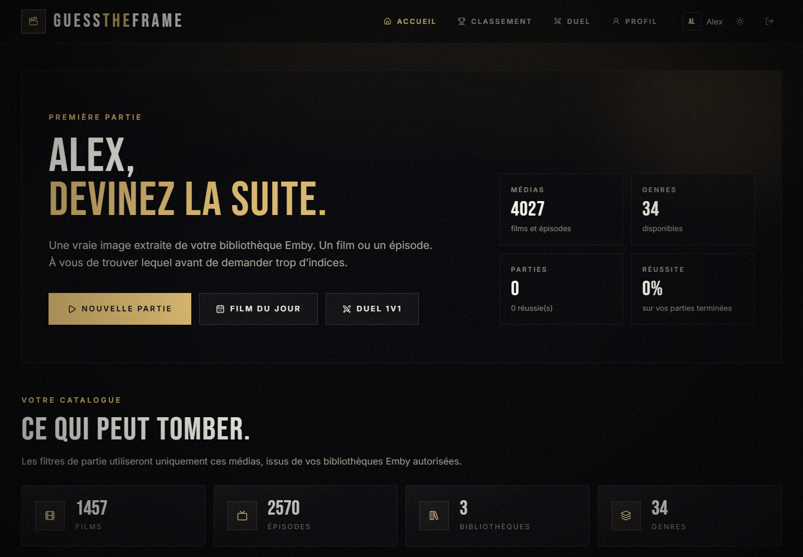
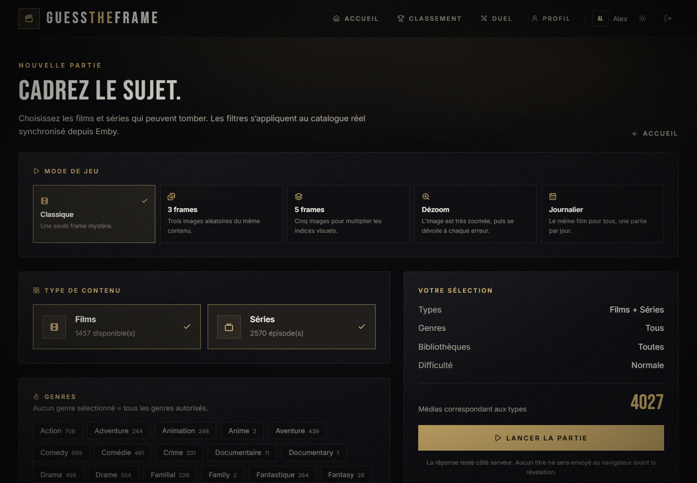
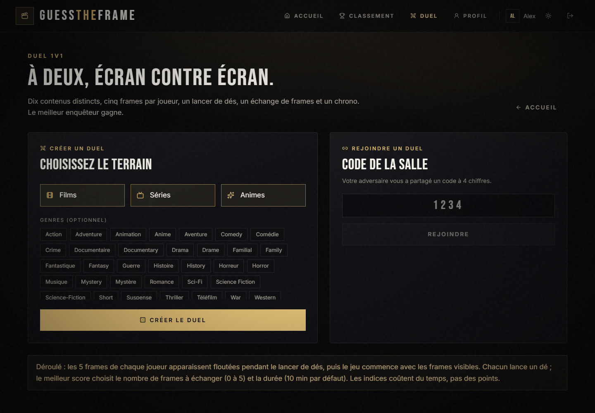
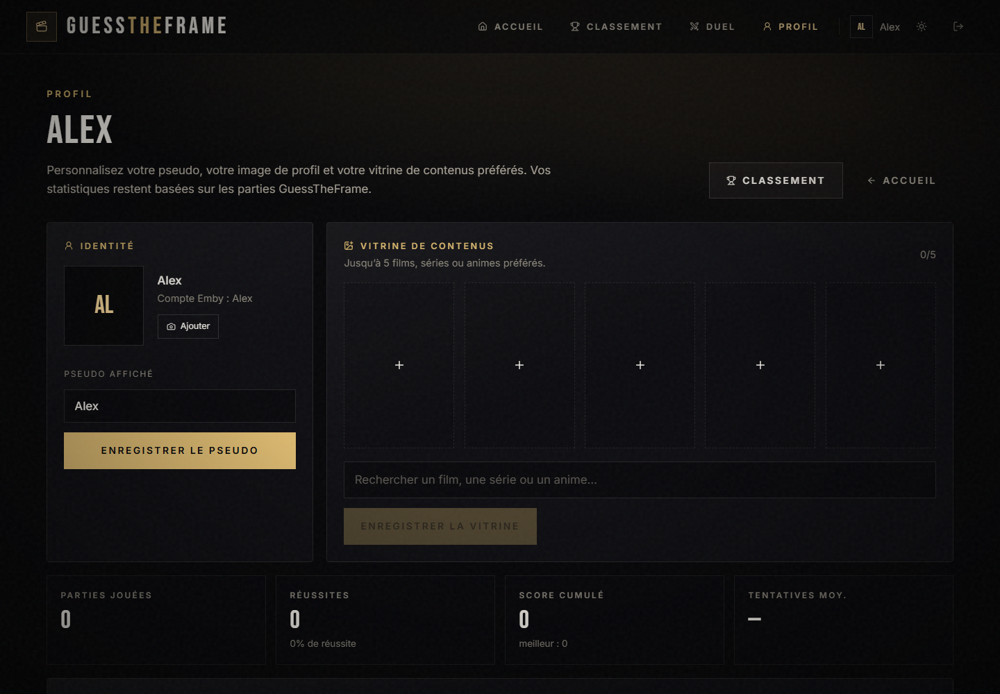
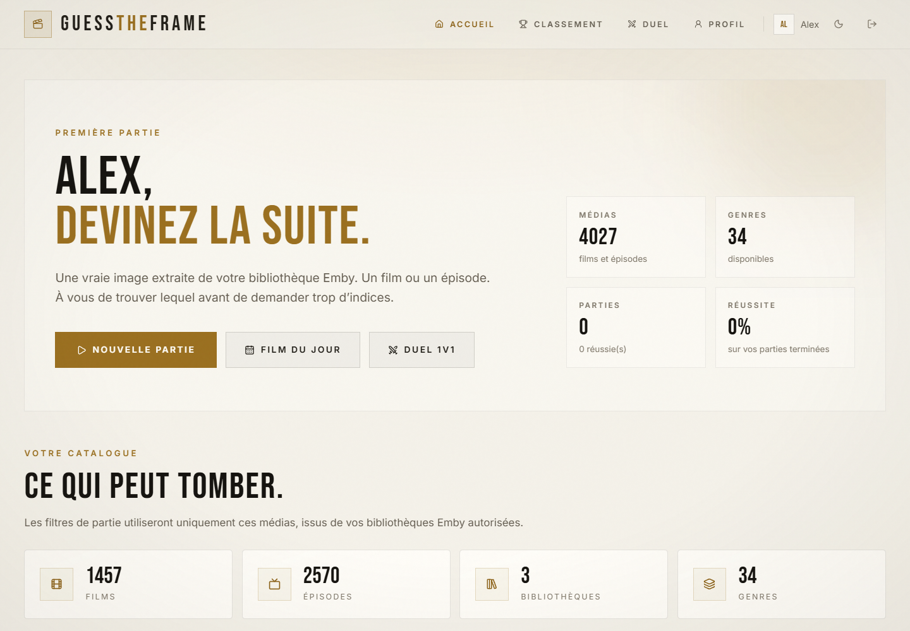
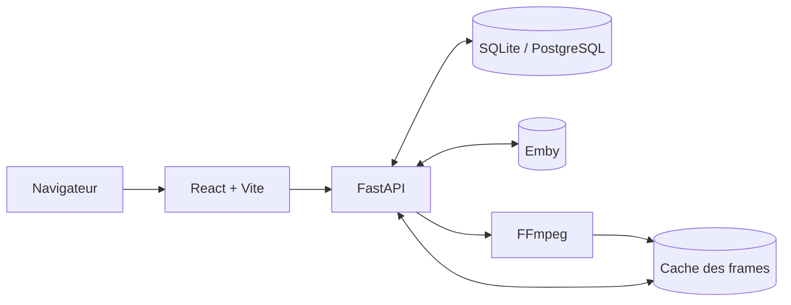

<div align="center">


<br />


**Transformez votre bibliothèque Emby en quiz cinéma et séries.**
Une vraie image extraite de la vidéo, un chrono, des indices, des duels 1v1 et des classements entre joueurs.

[Fonctionnalités](#-fonctionnalités) · [Aperçu](#-aperçu) · [Guide OMV](docs/DEPLOY-OMV.md) · [Installation Windows](#-installation-rapide-windows-11) · [Docker](#-déploiement-docker-production) · [Configuration](#-configuration) · [Dépannage](#-dépannage)

> 🖥️ **Serveur OMV / Debian 10 avec Docker ?**  
> Un guide pas à pas adapté à ta configuration est disponible : **[Déploiement sur OMV / Debian 10](docs/DEPLOY-OMV.md)**.

</div>

---

## 🎯 Le but de l'application

**GuessTheFrame** est un jeu de devinettes auto-hébergé qui utilise **Emby comme unique source de vérité**.

Le principe est simple : une image est extraite à un moment aléatoire d'un film ou d'un épisode de votre serveur. Aux joueurs de retrouver le titre. Pas d'affiche, pas de bande-annonce, pas de catalogue externe : uniquement de **vraies frames extraites par FFmpeg**.

L'application est pensée pour être utilisée au quotidien sur un réseau local, entre amis ou en famille :

- chacun se connecte avec **son propre compte Emby** ;
- les parties, scores et classements sont conservés par joueur ;
- les administrateurs gèrent le catalogue, les bibliothèques, les genres et les règles du jeu ;
- le tout fonctionne sans Docker en développement et avec PostgreSQL en production.

---

## ✨ Fonctionnalités

### 🎞️ Des frames réellement extraites de vos vidéos

- Extraction à la volée avec **FFmpeg** depuis le flux Emby.
- Jamais d'affiche ni d'image promotionnelle à la place d'une frame.
- Cache persistant, déduplication perceptuelle et rejet des images noires.
- Timestamp aléatoire hors générique quand Emby fournit les marqueurs.
- Aperçu plein écran avec **zoom molette**, déplacement à la souris et navigation entre les frames.

### 🎮 Modes de jeu solo

- **Classique** : une seule frame mystère.
- **3 frames** ou **5 frames** : plusieurs moments du même contenu.
- **Dézoom** : l'image commence très zoomée et se dévoile à chaque mauvaise réponse.
- **Journalier** : le même film pour tout le monde, une partie par jour.
- Filtres par **films, séries, genres, bibliothèques et difficulté**.
- Exclusion optionnelle des médias déjà devinés.

### ⚔️ Duel 1v1

- Création d'une salle avec un **code à 4 chiffres**.
- **10 contenus distincts** : 5 par joueur.
- Catégories **Films / Séries / Animes** séparées dans le choix du terrain.
- Le créateur ne voit **aucune frame** avant l'arrivée de l'adversaire.
- Lancer de dé à 6 faces, relance en cas d'égalité.
- Le gagnant du dé choisit le nombre de frames à échanger (0 à 5) et la durée.
- Échange de frames, puis jeu simultané avec toutes les frames visibles.
- **Chronos individuels** : impossible de répondre ou de demander un indice après la fin de son chrono.
- Le temps restant du joueur encore actif est mis en avant pour son adversaire.
- **Abandon** : l'adversaire gagne immédiatement.
- **Terminer maintenant** : proposition à l'adversaire, qui peut accepter ou refuser.
- **Annuler la partie** : proposition de match nul, non classée.
- Résultat détaillé : propriétaire de chaque frame, échanges, joueur ayant trouvé, indices découverts.
- **Classement 1v1** dédié.

### 🧠 Des indices utiles, jamais spoilants

- Date de sortie, réalisateur, acteurs, personnage principal, studio.
- Type de contenu, nom de l'épisode.
- **Saga** : indique seulement « Oui — N films », sans révéler le nom de la collection.
- **Séries** : indique seulement le nombre de saisons, sans révéler la série ni la saison.
- Les indices coûtent des points en solo et du temps en duel.
- Validation des réponses côté serveur, tolérante aux accents, apostrophes et petites fautes.

### 🏆 Classements

- **Général** : films + séries.
- **Films uniquement**.
- **Séries uniquement**.
- **Duels 1v1** : victoires, duels joués et taux de victoire.
- Périodes : général, 7 jours, 30 jours.
- Les parties journalières et les parties avec filtres personnalisés sont exclues des classements solo.
- Les duels annulés sont exclus du classement 1v1.
- Opt-out possible : un joueur peut masquer sa présence du classement public.

### 👤 Profils personnalisables

- **Pseudo affiché** dans l'interface, les duels et les classements.
- **Image de profil** importable (JPEG, PNG, WebP), redimensionnée automatiquement en 256 × 256.
- **Vitrine de 5 contenus préférés** : films, séries ou animes, avec recherche dans le catalogue et affiches officielles.
- Statistiques personnelles, historique des parties et préférences de classement.

### 🔄 Synchronisation Emby

- Synchronisation quotidienne automatique **à 12:00 (heure de Paris)**.
- Bouton **Actualiser le catalogue** pour un lancement manuel depuis l'administration.
- Les contenus supprimés d'Emby sont désactivés sans supprimer l'historique.
- Les métadonnées modifiées sont mises à jour.
- État de synchronisation consultable : ajoutés, mis à jour, retirés, erreurs.

### 🎨 Interface

- Thème **sombre** et thème **clair**, préférence conservée dans le navigateur.
- Interface desktop calibrée à **120 %**.
- Responsive mobile et tablette.
- Fenêtres de confirmation intégrées au style du jeu.
- Autocomplétion des titres issue du catalogue Emby.
- Footer dynamique : **Source de la base : [nom du serveur]**.

### 🛡️ Administration

- Configuration du serveur Emby et test de connexion.
- Bibliothèques et genres activables/désactivables.
- Barème, pénalités, difficultés et limites d'indices.
- Durée d'inactivité avant abandon automatique.
- Pénalité de temps des indices en duel.
- Gestion des utilisateurs, rôles et réinitialisation individuelle de l'historique.
- Cache des frames et purge depuis l'administration.

---

## 📸 Aperçu

<p align="center">
  
</p>

| Nouvelle partie | Duel 1v1 |
| :---: | :---: |
|  |  |

| Profil personnalisable | Thème clair |
| :---: | :---: |
|  |  |

---

## 🏗️ Architecture



| Couche | Technologie |
| --- | --- |
| Frontend | React 19, TypeScript, Vite, Tailwind CSS 4, TanStack Query, React Router |
| Backend | Python 3.12, FastAPI, SQLAlchemy 2 async, Pydantic v2, Alembic |
| Base locale | SQLite (WAL) |
| Base production | PostgreSQL 16 |
| Client Emby | httpx |
| Extraction vidéo | FFmpeg |
| Images | Pillow |
| Réponses | RapidFuzz |
| Chiffrement | cryptography (Fernet) |
| Tests | pytest, pytest-asyncio, respx |
| Déploiement | Docker Compose |

En développement, Vite sert l'interface sur `http://localhost:5174` et proxifie `/api` vers FastAPI sur `127.0.0.1:5274`.

---

## 🧭 Quel guide suivre ?

| Ton environnement | Guide recommandé |
| --- | --- |
| Windows 11, développement local | [Installation rapide Windows](#-installation-rapide-windows-11) |
| Serveur **OMV / Debian 10**, Docker 25+ | **[Déploiement OMV / Debian 10](docs/DEPLOY-OMV.md)** |
| Autre serveur Linux avec Docker | [Déploiement Docker générique](#-déploiement-docker-production) |

---

## 🚀 Installation rapide (Windows 11)

### Prérequis

- **Windows 11** (PowerShell 5.1 ou PowerShell 7).
- **Python 3.12** — [python.org](https://www.python.org/downloads/windows/) (cocher « Add python.exe to PATH »).
- **Node.js 20+** — [nodejs.org](https://nodejs.org/).
- **FFmpeg** recommandé pour les frames :
  ```powershell
  winget install Gyan.FFmpeg
  ```
- Un serveur **Emby** accessible et une **clé API** dédiée.
- Aucun Docker n'est nécessaire en développement.

### 1. Cloner le projet

```powershell
git clone https://github.com/XRayBarnabey/GuessTheFrame.git
cd GuessTheFrame
```

### 2. Installer

```powershell
powershell -ExecutionPolicy Bypass -File scripts\setup.ps1
```

Le script :

1. vérifie Python 3.12, Node.js et npm ;
2. crée l'environnement virtuel `.venv` ;
3. installe les dépendances backend et frontend ;
4. crée `.env` avec des secrets aléatoires ;
5. applique les migrations SQLite ;
6. affiche le **jeton d'installation**.

### 3. Démarrer

```powershell
powershell -ExecutionPolicy Bypass -File scripts\start.ps1
```

- Interface : <http://localhost:5174>
- API : <http://127.0.0.1:5274/api/health>
- Documentation API : <http://127.0.0.1:5274/api/docs>

Pour arrêter :

```powershell
powershell -ExecutionPolicy Bypass -File scripts\stop.ps1
```

### 4. Configurer Emby

1. Dans Emby : **Tableau de bord → Avancé → Sécurité → Ajouter une clé API**.
2. Nommez-la par exemple `GuessTheFrame`.
3. Ouvrez <http://localhost:5174/setup>.
4. Renseignez :
   - l'adresse du serveur, par exemple `http://192.168.1.50:8096` ;
   - la clé API ;
   - le jeton d'installation affiché par `scripts\setup.ps1` ;
   - l'option de vérification TLS.
5. Cliquez sur **Tester**, puis **Enregistrer**.

Les bibliothèques `movies` et `tvshows` sont activées par défaut. Les autres peuvent être activées dans l'administration.

### 5. Se connecter

Utilisez un compte Emby existant. Le mot de passe est transmis uniquement au backend, qui l'échange contre un jeton Emby. Il n'est jamais stocké.

Le compte dont le nom figure dans `GTF_ADMIN_EMBY_USERNAMES` devient administrateur GuessTheFrame. Par défaut :

```dotenv
GTF_ADMIN_EMBY_USERNAMES=admin
```

### 6. Synchroniser le catalogue

Ouvrir **Administration → Actualiser le catalogue**, ou attendre la synchronisation quotidienne de **12:00**.

---

## 🐳 Déploiement Docker (production)

> Le développement Windows ne nécessite pas Docker. Cette section concerne la production.
>
> **Serveur OMV / Debian 10 ?** Suis le guide dédié : **[Déploiement sur OMV / Debian 10](docs/DEPLOY-OMV.md)**. Il contient les commandes exactes pour Docker 25+, Compose v2, les secrets, le réseau Emby et les sauvegardes.

### Prérequis

- Linux avec **Docker Engine 24+** et **Docker Compose v2** (`docker compose version`).
- 2 Go d'espace disque libre minimum (images + cache des frames).
- Un nom de domaine et un reverse proxy TLS (Caddy, Traefik, Nginx) recommandé.
- Accès réseau au serveur Emby.

### Configuration

1. Copier le projet sur le serveur :

```bash
git clone https://github.com/XRayBarnabey/GuessTheFrame.git
cd GuessTheFrame
```

2. Créer `.env` à partir de `.env.example` :

```bash
cp .env.example .env
```

3. Générer les secrets :

```bash
# Clé Fernet pour chiffrer les secrets au repos
openssl rand -base64 32 | tr '+/' '-_'

# Jeton de première configuration
openssl rand -hex 32

# Mot de passe PostgreSQL (hexadécimal pour éviter les problèmes d'URL)
openssl rand -hex 24
```

4. Renseigner `.env` au minimum :

```dotenv
GTF_ENCRYPTION_KEY=<clé Fernet générée>
GTF_SETUP_TOKEN=<jeton généré>
GTF_ADMIN_EMBY_USERNAMES=admin
POSTGRES_PASSWORD=<mot de passe hexadécimal>
GTF_PUBLIC_URL=http://<IP_DU_SERVEUR>:8000
GTF_HTTP_PORT=8000
GTF_SESSION_COOKIE_SECURE=false
```

> En HTTP direct, `GTF_SESSION_COOKIE_SECURE` doit être `false`. Derrière HTTPS, passe-le à `true` et utilise `GTF_PUBLIC_URL=https://gtf.example.com`.

5. Si Emby tourne sur la même machine que Docker, renseigne son **IP LAN** dans l'écran de setup (ou `http://host.docker.internal:8096`). N'utilise pas `http://localhost:8096` : `localhost` désigne le conteneur.

### Lancer

```bash
docker compose up -d --build
docker compose ps
docker compose logs -f app
```

- Interface : `http://<IP_DU_SERVEUR>:8000`
- Setup : `http://<IP_DU_SERVEUR>:8000/setup`
- Santé : `http://<IP_DU_SERVEUR>:8000/api/health`
- L'application écoute sur le port `8000` par défaut, configurable avec `GTF_HTTP_PORT`.
- Les migrations Alembic sont appliquées automatiquement au démarrage.
- PostgreSQL n'est **pas** exposé sur l'hôte.
- Le conteneur applicatif inclut **FFmpeg**.
- Volumes persistants :
  - `gtf_db` : données PostgreSQL ;
  - `gtf_data` : données applicatives ;
  - `gtf_frames` : cache des frames.

### Reverse proxy HTTPS

Exemple Nginx :

```nginx
server {
    listen 443 ssl http2;
    server_name gtf.example.com;

    ssl_certificate     /etc/letsencrypt/live/gtf.example.com/fullchain.pem;
    ssl_certificate_key /etc/letsencrypt/live/gtf.example.com/privkey.pem;

    client_max_body_size 10m;

    location / {
        proxy_pass http://127.0.0.1:8000;
        proxy_http_version 1.1;
        proxy_set_header Host $host;
        proxy_set_header X-Real-IP $remote_addr;
        proxy_set_header X-Forwarded-For $proxy_add_x_forwarded_for;
        proxy_set_header X-Forwarded-Proto $scheme;
    }
}
```

Puis dans `.env` :

```dotenv
GTF_PUBLIC_URL=https://gtf.example.com
GTF_SESSION_COOKIE_SECURE=true
```

```bash
docker compose up -d
```

### Sauvegarde

```bash
mkdir -p /srv/backups/guesstheframe

docker compose exec -T db pg_dump -U gtf -d gtf \
  | gzip > /srv/backups/guesstheframe/gtf-$(date +%F).sql.gz

docker run --rm \
  -v guesstheframe_gtf_data:/data \
  -v /srv/backups/guesstheframe:/backup \
  alpine tar czf /backup/data-$(date +%F).tar.gz -C /data .
```

> Le préfixe `guesstheframe_` dépend du nom du projet Compose. Vérifie avec `docker volume ls | grep gtf`.

### Mise à jour

```bash
git pull
docker compose build app
docker compose up -d app
```

Sauvegarder la base avant toute mise à jour.

---

## ⚙️ Configuration

Copier `.env.example` vers `.env`. Les variables principales :

| Variable | Description |
| --- | --- |
| `GTF_ENV` | `development` ou `production` |
| `GTF_HOST` / `GTF_PORT` | Écoute du backend (5274 en dev) |
| `GTF_HTTP_PORT` | Port HTTP exposé par Docker Compose (8000 par défaut) |
| `TZ` | Fuseau horaire du conteneur (`Europe/Paris` par défaut) |
| `GTF_FRONTEND_URL` | URL publique de l'interface |
| `GTF_DATABASE_URL` | SQLite en dev, PostgreSQL en prod |
| `GTF_ENCRYPTION_KEY` | Clé Fernet pour les secrets |
| `GTF_SETUP_TOKEN` | Jeton de première configuration |
| `GTF_ADMIN_EMBY_USERNAMES` | Admins séparés par des virgules |
| `GTF_SESSION_COOKIE_SECURE` | `true` derrière HTTPS |
| `GTF_SESSION_IDLE_DAYS` | Expiration glissante |
| `GTF_SESSION_ABSOLUTE_DAYS` | Expiration absolue |
| `GTF_FRAME_CACHE_DIR` | Répertoire du cache des frames |
| `GTF_FRAME_CACHE_MAX_MB` | Taille maximale prévue |
| `GTF_FFMPEG_PATH` | Chemin explicite de FFmpeg (optionnel) |
| `GTF_FFMPEG_TIMEOUT_SECONDS` | Timeout d'extraction |
| `GTF_FFMPEG_CONCURRENCY` | Extractions simultanées |
| `GTF_EMBY_URL` | URL initiale proposée au setup |
| `GTF_EMBY_VERIFY_TLS` | Vérification TLS initiale |
| `GTF_LOG_LEVEL` | Niveau de logs |
| `GTF_PUBLIC_URL` | URL publique du conteneur |
| `POSTGRES_PASSWORD` | Mot de passe PostgreSQL Docker |

Les paramètres Emby saisis dans l'interface sont stockés en base, pas dans `.env`.

---

## 🕹️ Utilisation

### Partie solo

1. **Nouvelle partie** : choisir mode, types, genres, bibliothèques et difficulté.
2. Observer la frame.
3. Proposer un titre ou demander un indice.
4. Valider. Le score et la réponse sont calculés côté serveur.
5. Consulter le résultat, les métadonnées et le lien Emby.

### Duel 1v1

1. **Duel** : choisir Films / Séries / Animes et éventuellement des genres.
2. Créer la salle et partager le code à 4 chiffres.
3. L'adversaire rejoint avec le code.
4. Chacun lance son dé ; le meilleur score règle la partie.
5. Sélectionner les frames à échanger, puis jouer.
6. Deviner dans l'ordre souhaité ; les indices coûtent du temps.
7. À la fin, consulter le résultat détaillé et le classement 1v1.

### Profil

- Modifier son **pseudo**.
- Ajouter ou supprimer une **image de profil**.
- Composer sa **vitrine** de 5 contenus préférés.
- Choisir d'apparaître ou non dans le classement public.

### Administration

- Serveur Emby et test de connexion.
- Synchronisation manuelle et planification quotidienne.
- Bibliothèques et genres.
- Barème, indices, difficultés, inactivité et pénalité de duel.
- Utilisateurs et réinitialisation d'historique.
- Cache des frames.

---

## 🔐 Sécurité

- Cookie de session `HttpOnly`, `SameSite=Lax`, `Secure` en production HTTPS.
- Token de session opaque stocké **haché** (SHA-256).
- Token Emby et clé API **chiffrés au repos** (Fernet).
- Mot de passe Emby jamais stocké, jamais loggé, jamais renvoyé au navigateur.
- CSRF par jeton de synchronisation pour toutes les mutations.
- Rate limiting sur la connexion, le setup et les frames.
- Rôles administrateur vérifiés à chaque requête.
- Validation Pydantic et ORM SQLAlchemy, pas de SQL concaténé.
- Réponses de partie sans titre, identifiant ou métadonnée avant la révélation.
- Images et affiches servies par des routes backend protégées.
- En-têtes de sécurité HTTP et CSP à renforcer selon le reverse proxy.

---

## 🧱 Structure du projet

```text
GuessTheFrame/
├── backend/
│   ├── app/
│   │   ├── auth/          sessions, dépendances, connexion Emby
│   │   ├── core/          configuration, crypto, erreurs, logs, rate limit
│   │   ├── db/            modèles SQLAlchemy, session
│   │   ├── duels/         état du duel 1v1, échanges, propositions, résultats
│   │   ├── emby/          client REST Emby, synchronisation
│   │   ├── frames/        extraction FFmpeg, BIF, cache
│   │   ├── games/         sélection, réponses, indices, score, service, routes
│   │   ├── routers/       santé, setup, auth, catalogue, admin, leaderboard, profil, médias
│   │   └── services/      paramètres applicatifs
│   ├── alembic/           migrations
│   └── tests/             tests automatisés
├── frontend/
│   └── src/
│       ├── auth/          contexte et gardes de routes
│       ├── components/    UI, formulaires, aperçu images, dialogues
│       ├── pages/         accueil, jeu, duel, classement, profil, admin
│       └── lib/           client API, types, thème
├── docs/                  analyse technique, bannière, captures
├── scripts/               setup, start, stop, test (PowerShell)
├── data/                  SQLite + cache local (non versionné)
├── Dockerfile
├── docker-compose.yml
└── README.md
```

---

## 🧪 Tests

```powershell
powershell -ExecutionPolicy Bypass -File scripts\test.ps1
```

Ou séparément :

```powershell
Push-Location backend
..\.venv\Scripts\python.exe -m pytest -q
Pop-Location

Push-Location frontend
npm run build
npm run lint
Pop-Location
```

Les tests backend simulent Emby avec `respx` : connexion, setup, synchronisation, sélection, réponses, indices, score, classements solo et 1v1, cycle complet d'un duel, abandon, annulation, fin anticipée, expiration des chronos, profil, avatar, vitrine, sessions, CSRF et routes API.

**État v1.0.0 : 46 tests backend passent, build frontend OK.**

---

## 🩺 Dépannage

| Symptôme | Piste |
| --- | --- |
| `python` introuvable | Installer Python 3.12 et cocher « Add to PATH », ou utiliser `py -3.12`. |
| Le frontend ne démarre pas | Vérifier `node --version`, puis relancer `scripts\setup.ps1`. |
| Port occupé | Lancer `scripts\stop.ps1`, vérifier les processus sur 5174/5274. |
| Emby injoignable | Vérifier l'URL, le port, le réseau, le pare-feu et que le serveur est démarré. |
| Emby dans Docker avec `localhost` | `localhost` désigne le conteneur : utiliser l'IP LAN d'Emby ou `host.docker.internal`. |
| `docker compose` introuvable | Installer le plugin Docker Compose v2 (voir le guide OMV). |
| Connexion qui boucle en HTTP | Passer `GTF_SESSION_COOKIE_SECURE=false` pour le test HTTP, ou servir l'application en HTTPS. |
| Clé API refusée | Recréer une clé dans Emby et la saisir à nouveau dans l'administration. |
| Aucun média après synchro | Vérifier que la bibliothèque est activée et contient des films/épisodes avec fichiers vidéo. |
| Erreur PostgreSQL `value too long for type character varying(64)` | Mettre à jour l'image puis relancer `docker compose up -d --build` : la migration `8ed256215496` élargit le champ des tags d'affiche. |
| Frame indisponible | Vérifier FFmpeg (`ffmpeg -version`), les droits d'accès au flux Emby et les logs backend. |
| Image noire | Le pipeline réessaie plusieurs timestamps ; si le média est atypique, l'erreur est affichée. |
| Contenu supprimé encore visible | Lancer **Actualiser le catalogue** ; la synchronisation désactive les médias absents. |
| Indice saga/saisons absent | Les métadonnées de collection ou de saisons ne sont pas renseignées dans Emby. |
| Session perdue | Le compte Emby a peut-être été désactivé ou le token révoqué : se reconnecter. |

Logs locaux :

- `logs\backend.out.log`
- `logs\backend.err.log`
- `logs\frontend.out.log`
- `logs\frontend.err.log`

---

## 🗺️ Feuille de route

- [x] Phase 1 — analyse technique et architecture
- [x] Phase 2 — socle Windows, SQLite, scripts, frontend/backend
- [x] Phase 3 — intégration Emby, setup, authentification, synchronisation
- [x] Phase 4 — moteur de partie, frame FFmpeg, validation, révélation
- [x] Phase 5 — filtres, indices, score, historique, leaderboard, profils, administration
- [x] Phase 6 — interface responsive et direction artistique
- [x] Phase 7 — tests automatisés backend
- [x] Phase 8 — Dockerfile, compose, documentation de déploiement
- [x] Phase 9 — duel 1v1, classement 1v1 et indices saga/saisons sans fuite de nom
- [x] Phase 10 — catégories animes, profil personnalisable, vitrine et synchronisation quotidienne

---

## 📄 Licence et usage

Projet personnel publié pour permettre à d'autres serveurs Emby de profiter du jeu.

Les médias, métadonnées et images restent la propriété de leurs ayants droit. GuessTheFrame ne fournit aucun contenu et ne contourne aucune protection : l'application lit uniquement les médias auxquels l'utilisateur Emby a accès.

---

<div align="center">

**GuessTheFrame v1.0.0**

Fait avec ❤️ pour les serveurs Emby.

</div>
