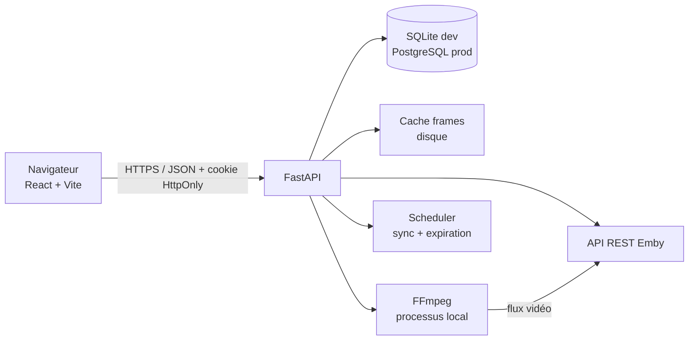

# GuessTheFrame — Phase 1 : analyse technique et architecture

> Statut : **analyse terminée, développement non démarré**
> Date : 6 novembre 2026
> Périmètre : étude de l'API Emby, faisabilité de l'extraction de frames, architecture, modèle de données, sécurité, plan de développement.

---

## 1. Résumé exécutif

GuessTheFrame peut être développé comme une application web réelle, sans Docker, sous Windows 11, avec :

- **Frontend** : React + Vite + TypeScript, servi en développement sur `http://localhost:5174`.
- **Backend** : Python 3.12 + FastAPI + SQLAlchemy 2 + Alembic.
- **Base de développement** : SQLite (aucun serveur à installer).
- **Base de production** : PostgreSQL (même code, même ORM, migrations Alembic).
- **Source des médias** : uniquement l'API REST Emby.
- **Frames** : extraction **FFmpeg à la demande** depuis le flux vidéo Emby, avec cache persistant ; solutions natives Emby (images de chapitres, preview thumbnails/BIF) utilisées en secours. **Aucune affiche ne sera utilisée comme frame.**
- **Sessions** : cookies HttpOnly, sessions opaques côté serveur, tokens Emby chiffrés côté backend, jamais exposés au navigateur.
- **Déploiement futur** : une image Docker applicative + PostgreSQL, sans réécriture.

Le point critique du projet est la récupération d'une **vraie frame aléatoire**. La documentation Emby ne propose **aucun endpoint REST public permettant d'extraire une image à un timestamp arbitraire**. La stratégie fiable consiste donc à laisser l'application extraire elle-même la frame depuis le flux vidéo Emby avec FFmpeg, tout en utilisant les images natives d'Emby comme secours. Ce point doit être validé très tôt contre le serveur réel de l'utilisateur (Phase 3/4).

---

## 2. État de l'environnement de développement constaté

Vérifications effectuées sur la machine :

| Élément | État |
|---|---|
| Windows | Windows 11 (environnement OpenCode) |
| Python | 3.14.4 par défaut, **3.12.10 également disponible** |
| Node.js | 24.21.0 |
| npm | 11.19.0 |
| FFmpeg | 7.1.1-full, présent dans le `PATH` (installation WinGet) |
| Docker | non utilisé, non requis |
| Dépôt Git | le dossier projet est actuellement vide |

Décisions :

- Le backend ciblera **Python 3.12** (compatibilité large des wheels : pydantic-core, asyncpg, Pillow, etc.) et non 3.14, plus risqué pour certaines dépendances.
- FFmpeg est déjà installé, mais l'application ne le supposera jamais : chemin configurable (`FFMPEG_PATH`), détection automatique, diagnostic dans l'administration.
- Aucun chemin absolu propre à la machine ne sera codé dans le projet.

---

## 3. Étude de l'API Emby

Documentation consultée :

- Vue d'ensemble : <https://dev.emby.media/doc/restapi/index.html>
- Authentification utilisateur : <https://dev.emby.media/doc/restapi/User-Authentication.html>
- Authentification par clé API : <https://dev.emby.media/doc/restapi/API-Key-Authentication.html>
- Images : <https://dev.emby.media/doc/restapi/Images.html>
- Navigation dans les bibliothèques : <https://dev.emby.media/doc/restapi/Browsing-the-Library.html>
- Informations d'un média : <https://dev.emby.media/doc/restapi/Item-Information.html>
- Référence REST : <https://dev.emby.media/reference/RestAPI.html>

### 3.1 URL de base

```
http(s)://<hôte>:<port>/emby/<chemin>
```

Exemple : `http://192.168.1.20:8096/emby`.

L'URL finale sera construite à partir de la configuration administrateur (protocole, hôte, port, éventuel préfixe), sans slash final, et validée par un appel de santé.

### 3.2 Authentification

Deux modes existent :

1. **Authentification utilisateur** — pour connecter un utilisateur Emby :
   - `POST /Users/AuthenticateByName`
   - en-tête obligatoire de type :
     `X-Emby-Authorization: Emby Client="GuessTheFrame", Device="Web", DeviceId="<uuid stable>", Version="1.0.0"`
   - corps JSON : `{"Username": "...", "Pw": "..."}`
   - réponse : objet `AuthenticationResult` contenant `User`, `AccessToken`, `ServerId`.
   - les appels suivants utilisent `X-Emby-Token: <AccessToken>`.

2. **Clé API** — pour les tâches serveur (synchronisation du catalogue, vérification, extraction) :
   - en-tête `X-Emby-Token: <clé API>` ou paramètre `api_key`.
   - recommandation Emby : une clé dédiée par intégration, révocable.

Conséquences de conception :

- Le mot de passe Emby transite **une seule fois** vers le backend, n'est **jamais stocké**, jamais loggé, jamais renvoyé.
- Le `AccessToken` utilisateur est conservé **chiffré** (Fernet) dans la session serveur, uniquement pour les appels agissant au nom de l'utilisateur. Il est supprimé à la déconnexion et à l'expiration.
- La **clé API** est stockée chiffrée en base, configurée par l'administrateur, jamais renvoyée au frontend (seul un booléen « configurée » est exposé).
- Le `UserId` Emby est l'identifiant unique des statistiques et du leaderboard.
- Le statut `User.Policy.IsDisabled` est vérifié à la connexion et périodiquement pendant la session.

### 3.3 Catalogue

Endpoints utiles :

| Besoin | Endpoint |
|---|---|
| Serveur disponible / nom / version | `GET /System/Info/Public` |
| Vérification authentifiée + informations serveur | `GET /System/Info` (clé API) |
| Bibliothèques | `GET /Library/MediaFolders` (contexte admin) ou `GET /Users/{userId}/Views` |
| Médias d'une bibliothèque | `GET /Items?ParentId=...&Recursive=true&IncludeItemTypes=Movie,Episode&...` |
| Médias visibles par un utilisateur | `GET /Users/{userId}/Items?...` |
| Détail d'un média | `GET /Users/{userId}/Items/{id}` ou `GET /Items/{id}` |
| Vérifier l'accès d'un utilisateur à un média | `GET /Users/{userId}/Items?Ids={id}` |

Champs à demander lors de la synchronisation (`Fields`) :

```
DateCreated, DateModified, Genres, Overview, People, ProviderIds,
Path, MediaSources, MediaStreams, ProductionYear, PremiereDate,
RunTimeTicks, OfficialRating, CommunityRating, SortName,
Chapters, PrimaryImageAspectRatio, Studios, Taglines
```

Remarques importantes :

- Les listes renvoient un objet tronqué : il faut explicitement demander les champs.
- `MediaSources` contient l'identifiant de la source à utiliser pour le streaming (`MediaSourceId`) et les métadonnées techniques (conteneur, durée, résolution, HDR, etc.).
- `Chapters[].MarkerType` peut valoir `IntroStart`, `IntroEnd`, `CreditsStart` lorsque la détection d'intro/crédits est activée dans Emby. Cela permet d'éviter certaines zones, sans garantie si la fonctionnalité n'est pas activée.
- `People[].Type` distingue `Director`, `Actor`, etc. Les métadonnées absentes ne doivent jamais être inventées : l'indice correspondant est simplement indisponible.
- Les épisodes exposent `SeriesId`, `SeriesName`, `SeasonId`, `ParentIndexNumber` (saison), `IndexNumber` (épisode), mais pas toujours le titre original de la série. La synchronisation récupérera aussi les objets `Series` des bibliothèques TV pour disposer du titre original de la série et de ses variantes.

### 3.4 Synchronisation

Principes retenus :

- Synchronisation **admin** via clé API, dans une tâche de fond asynchrone.
- Pagination par lots (ex. 200 items) avec `StartIndex` / `Limit`, afin de ne jamais charger tout le catalogue en mémoire.
- **Upsert** par `(server_id, emby_item_id)`.
- Comparaison de `DateModified` / `Etag` pour éviter les écritures inutiles.
- Après un scan complet réussi : les médias non revus sont marqués `is_active = false` (supprimés d'Emby), pas supprimés physiquement, afin de conserver l'historique des parties.
- Les médias réapparus sont réactivés.
- Une synchro ne doit jamais bloquer l'utilisation : verrou `sync_running`, statut consultable, erreurs enregistrées.
- Déclenchement : au démarrage si le catalogue est vide ou trop ancien, manuellement depuis l'admin, et périodiquement (intervalle configurable, 6 h par défaut).
- La sélection d'une partie vérifie en plus, avec le token de l'utilisateur, que le média choisi lui est accessible (contrôle parental / bibliothèques restreintes). Un média inaccessible est écarté et un autre est tiré.

### 3.5 Images et frames : ce qui existe réellement

| Source | Endpoint / mécanisme | Nature | Qualité | Aléatoire ? | Dépendance |
|---|---|---|---|---|---|
| Affiche / backdrop / logo | `GET /Items/{id}/Images/{Type}` | Image éditoriale | haute | non | métadonnées |
| Image de chapitre | `GET /Items/{id}/Images/Chapter/{index}` | Frame réelle au début d'un chapitre | moyenne | limitée aux chapitres | extraction de chapitres activée |
| Preview thumbnails (BIF) | `GET /Videos/{id}/index.bif` | Tuiles/JPEG réels échantillonnés (souvent toutes les 10 s) | souvent basse (ex. 320×180) | oui, mais échantillonnage fixe | « Generate video preview thumbnails » activé |
| Screenshot / image extraite | type `Screenshot` selon les cas | image générée/extraite | variable | non | plugin / configuration |
| Frame à un timestamp arbitraire | **aucun endpoint REST public documenté** | — | — | — | — |
| Flux vidéo | `GET /Videos/{id}/stream?Static=true&MediaSourceId=...` | fichier original streamé | source | oui (via FFmpeg) | accès utilisateur/clé |

Conclusion :

1. **Aucune API Emby documentée ne permet de demander « la frame à 12 min 34 s ».** L'extraction d'images existe en interne (`EncodingManager`, `IImageExtractionManager`) mais n'est pas exposée comme service REST public.
2. Les images natives sont utiles mais insuffisantes comme source principale :
   - les images de chapitres ne sont pas assez aléatoires et dépendent des chapitres ;
   - les preview thumbnails sont souvent en basse résolution et dépendent d'une option de bibliothèque ;
   - les affiches/backdrops sont **interdits** par le cahier des charges.
3. La solution principale sera donc **FFmpeg côté backend**, à partir du flux vidéo Emby, avec :
   - timestamp aléatoire dans une plage exploitable ;
   - extraction d'une seule image (pas de téléchargement complet) ;
   - cache persistant ;
   - détection des images noires/uniformes ;
   - déduplication perceptuelle ;
   - timeout et gestion d'erreur ;
   - fallback vers les images natives Emby si FFmpeg est indisponible ou échoue.

Cette conclusion est basée sur la documentation officielle. Elle sera **validée physiquement** en Phase 3/4 avec le serveur Emby réel (support des requêtes HTTP Range, accès au flux, vitesse d'extraction).

### 3.6 Accès au flux vidéo

Deux approches sont prévues, dans cet ordre :

**A. Flux original statique (préféré)**

```
GET /emby/Videos/{itemId}/stream?Static=true&MediaSourceId={mediaSourceId}
```

- en-tête `X-Emby-Token`.
- FFmpeg effectue un seek d'entrée (`-ss` avant `-i`) ; si le serveur Emby honore les requêtes HTTP `Range`, seuls les octets nécessaires autour du point de seek sont téléchargés.
- À valider sur le serveur réel : réponse `206 Partial Content` et support de `Range`.

**B. Flux transcodé à partir d'un offset (secours)**

```
GET /emby/Videos/{itemId}/stream?...&StartTimeTicks={ticks}&VideoCodec=h264...
```

- Emby démarre un transcodage au timestamp demandé ; FFmpeg lit quelques secondes et capture une frame.
- Plus coûteux en CPU pour le serveur Emby, mais robuste si le seek HTTP direct n'est pas possible.
- Utilisé uniquement en secours, avec un réglage administrateur.

**Ne jamais** exposer l'URL Emby ou le token au navigateur : le navigateur ne voit qu'une route backend `/api/games/{id}/frame` protégée.

### 3.7 Lien « Regarder sur Emby »

L'API Emby ne fournit pas d'URL web canonique dans les objets média. La convention du client web Emby est :

```
{emby_base}/web/index.html#!/item?id={itemId}&serverId={serverId}
```

Cette URL sera :

- construite côté backend à partir de la configuration serveur ;
- validée en Phase 4 sur le serveur réel ;
- accompagnée d'un repli vers la racine du serveur Emby si le format n'est pas reconnu ;
- **jamais** une URL de lecture inventée avec un token dans l'URL.

---

## 4. Faisabilité et pipeline d'extraction des frames

### 4.1 Sélection du timestamp

Pour un média de durée `D` :

1. Calculer une fenêtre exploitable :
   - début : `max(90 s, 6 % de D)` ;
   - fin : `min(D - 120 s, 92 % de D)`.
2. Si des marqueurs Emby existent :
   - exclure `[IntroStart, IntroEnd]` ;
   - exclure après `CreditsStart`.
3. Tirer un timestamp aléatoire uniforme dans la fenêtre.
4. Éviter les doublons : timestamp non utilisé récemment pour ce média, distance minimale (ex. 45 s) et hash perceptuel différent des dernières frames.
5. Pour les contenus courts (< 5 min), réduire les marges proportionnellement, avec un minimum de sécurité.

### 4.2 Extraction

Commande type (le token est passé par en-tête, jamais par l'URL) :

```text
ffmpeg -hide_banner -loglevel error
  -headers "X-Emby-Token: <token>\r\n"
  -ss 1234.500
  -i "http://<emby>/emby/Videos/<id>/stream?Static=true&MediaSourceId=<msid>"
  -map 0:v:0 -frames:v 1 -an -sn
  -vf "scale=1280:-2"
  -q:v 3 -y "<cache>/<clé>.jpg"
```

Points techniques :

- `-ss` **avant** `-i` : seek rapide.
- `-frames:v 1` : une seule image.
- `-map 0:v:0` : évite les flux image intégrés.
- `-an -sn` : pas d'audio ni de sous-titres.
- sortie JPEG largeur 1280 px (configurable), ratio préservé.
- timeout global (ex. 30 s) et taille de sortie maximale.
- si HDR détecté (`MediaStreams[].VideoRange`), appliquer un tone mapping (filtre `zscale`/`tonemap`) pour éviter une image délavée ; à valider selon la build FFmpeg.
- écriture dans un fichier temporaire puis **rename atomique** vers le cache, pour ne jamais servir un fichier partiel.

### 4.3 Contrôle qualité

Après extraction, avec Pillow :

- rejeter les images quasi noires (luminance moyenne trop faible) ;
- rejeter les images quasi uniformes (écart-type / nombre de couleurs trop faible) ;
- rejeter les images trop petites ou corrompues ;
- calculer un hash perceptuel (pHash) et rejeter les doublons proches ;
- réessayer avec un autre timestamp (maximum 4 tentatives) ;
- si toutes les tentatives échouent : passer au fallback natif, puis renvoyer une erreur explicite. **Jamais d'affiche à la place.**

Limite assumée : il est impossible de garantir à 100 % l'absence de cartons de titre, de logos de studio ou de visages très reconnaissables. Les fenêtres et marqueurs réduisent le risque ; le résultat reste une véritable frame du média.

### 4.4 Fallbacks natifs

Ordre :

1. FFmpeg sur flux statique (défaut).
2. FFmpeg sur flux transcodé à offset (si le seek direct échoue).
3. Image de chapitre Emby (frame réelle, choisie parmi les chapitres disponibles).
4. Preview thumbnail BIF Emby (frame réelle basse résolution, timestamp le plus proche).
5. Erreur utilisateur claire : « Impossible d'extraire une image pour ce média. Réessayez ou choisissez un autre média. »

Le mode peut être forcé dans l'administration (`auto`, `ffmpeg`, `emby`) pour diagnostic.

### 4.5 Cache

- Répertoire configurable hors code source : `data/frames/` (dev) ou volume Docker (prod).
- Clé : `sha256(server_id | item_id | media_source_id | timestamp_ms | largeur)`.
- Arborescence shardée (`ab/cd/<clé>.jpg`) pour éviter les dossiers géants.
- Table `frame_cache` : clé, média, timestamp, source, dimensions, taille, pHash, dates.
- Une partie conserve **une seule frame** (`games.frame_cache_key`) : recharger la page ne change pas l'image.
- Nettoyage : limite de taille (ex. 2 Go) et d'âge (ex. 90 jours), LRU ; purge manuelle depuis l'admin.
- En-têtes : `Cache-Control: private, max-age=86400`, `ETag`, `X-Content-Type-Options: nosniff`.
- Route protégée : session valide + partie appartenant à l'utilisateur + partie en cours ou terminée.

### 4.6 Concurrence et performances

- Sémaphore global (2 extractions simultanées par défaut) pour ne pas saturer le CPU.
- File d'attente courte + timeout ; le frontend affiche un état de chargement.
- Les frames déjà en cache sont servies instantanément.
- Un préchargement de la frame est déclenché à la création de la partie, avant l'affichage de l'écran de jeu.
- Métriques admin : temps moyen d'extraction, taux d'échec, taille du cache.

---

## 5. Architecture proposée

### 5.1 Vue d'ensemble



- **Un seul domaine applicatif** : en production, FastAPI sert le build React et l'API. En développement, Vite sert l'interface et proxy `/api` vers FastAPI, ce qui évite les problèmes de CORS et de cookies.
- Aucun accès direct du navigateur à Emby.
- Aucune donnée fictive en production : le catalogue provient exclusivement d'Emby.

### 5.2 Stack retenue

| Couche | Choix | Justification |
|---|---|---|
| Frontend | React 19, TypeScript, Vite | standard, rapide, écosystème mature |
| Routage | React Router | simple, adapté aux pages |
| Données front | TanStack Query | cache, invalidation, états de chargement |
| Styles | Tailwind CSS + design tokens CSS | responsive, cohérent, rapide à maintenir |
| Icônes | lucide-react | léger |
| i18n | react-i18next | français par défaut, extensible |
| Backend | FastAPI, Python 3.12 | API typée, async, documentation OpenAPI |
| ORM | SQLAlchemy 2 (async) | abstraction SQLite/PostgreSQL |
| Migrations | Alembic | schéma versionné, prod |
| Validation | Pydantic v2 | entrées/sorties typées |
| HTTP | httpx (async) | appels Emby, timeouts, tests mockés |
| DB dev | SQLite + aiosqlite, mode WAL | zéro installation |
| DB prod | PostgreSQL + asyncpg | concurrence, robustesse |
| Images | Pillow | validation, pHash, dimensions |
| Réponses | RapidFuzz | similarité contrôlée |
| Chiffrement | cryptography (Fernet) | tokens/clé API au repos |
| Extraction | FFmpeg | frames réelles |
| Tests | pytest, pytest-asyncio, respx | Emby simulé uniquement en test |
| Serveur | Uvicorn | dev et prod |

Aucune dépendance à Docker en développement.

### 5.3 Organisation du code

```text
GuessTheFrame/
├─ backend/
│  ├─ app/
│  │  ├─ main.py
│  │  ├─ core/            # config, logging, erreurs, sécurité, rate limit
│  │  ├─ db/              # session, base, modèles
│  │  ├─ emby/            # client HTTP, auth, catalogue, images, liens
│  │  ├─ frames/          # extracteur FFmpeg, BIF, cache, qualité
│  │  ├─ games/           # sélection, réponses, indices, score, routes
│  │  ├─ stats/           # leaderboard, profil
│  │  ├─ admin/           # configuration, synchro, maintenance
│  │  ├─ auth/            # login, sessions, dépendances
│  │  └─ workers/         # scheduler, expiration
│  ├─ alembic/
│  ├─ tests/
│  ├─ pyproject.toml
│  └─ requirements.txt
├─ frontend/
│  ├─ src/
│  │  ├─ app/             # providers, router
│  │  ├─ api/             # client typé
│  │  ├─ features/        # auth, home, game, result, leaderboard, profile, admin
│  │  ├─ components/      # UI réutilisable
│  │  ├─ i18n/
│  │  └─ styles/
│  ├─ package.json
│  └─ vite.config.ts
├─ scripts/
│  ├─ setup.ps1
│  ├─ start.ps1
│  ├─ stop.ps1
│  └─ test.ps1
├─ data/                  # base SQLite + cache (gitignored)
├─ docs/
├─ .env.example
├─ Dockerfile
├─ docker-compose.yml
├─ .dockerignore
└─ README.md
```

### 5.4 Endpoints API prévus

**Public / configuration**

- `GET /api/health`
- `GET /api/setup/status`
- `POST /api/setup/emby` (protégé par un jeton d'installation à usage unique)
- `GET /api/auth/server-status`

**Authentification**

- `POST /api/auth/login` `{username, password}`
- `POST /api/auth/logout`
- `GET /api/auth/me`

**Jeu**

- `GET /api/game/options` → types, genres, bibliothèques, difficultés, compteurs
- `POST /api/games` → crée une partie, renvoie l'état public
- `GET /api/games/{id}` → état public (jamais la réponse)
- `GET /api/games/{id}/frame` → JPEG de la frame
- `POST /api/games/{id}/attempts` → `{guess}` ; retourne correct/incorrect + tentative ; si correct, résultat complet
- `POST /api/games/{id}/hints` → révèle l'indice suivant
- `POST /api/games/{id}/abandon` → révèle et termine à 0 point
- `GET /api/games/{id}/result` → disponible uniquement si terminée

**Statistiques**

- `GET /api/leaderboard?period=all|week|month`
- `GET /api/users/me/stats`
- `GET /api/users/me/games?page=...`

**Administration** (rôle admin obligatoire)

- `GET/PUT /api/admin/settings`
- `POST /api/admin/emby/test`
- `GET /api/admin/libraries`, `PUT /api/admin/libraries/{id}`
- `POST /api/admin/sync`, `GET /api/admin/sync/status`
- `GET /api/admin/genres`, `PUT /api/admin/genres/{name}`
- `GET /api/admin/users`, `PUT /api/admin/users/{id}`
- `GET /api/admin/stats`
- `GET /api/admin/cache`, `POST /api/admin/cache/purge`

Toutes les réponses d'erreur suivent un format stable :

```json
{"error": {"code": "EMBY_UNAVAILABLE", "message": "...", "details": {}}}
```

Le frontend traduit les codes en messages français ; le backend ne renvoie jamais de stack trace.

---

## 6. Modèle de données

### 6.1 Tables principales

**`users`**

- `id` (PK)
- `emby_user_id` (unique avec `emby_server_id`)
- `emby_server_id`
- `username`, `username_norm`
- `is_admin`, `is_active`
- `created_at`, `last_login_at`, `last_seen_at`

**`sessions`**

- `id` (PK)
- `user_id` (FK)
- `token_hash` (unique, SHA-256 du cookie opaque)
- `emby_token_enc` (chiffré)
- `csrf_secret`
- `created_at`, `last_seen_at`, `expires_at`, `revoked_at`
- `ip`, `user_agent`

**`app_settings`** (une ligne)

- URL Emby, clé API chiffrée, server_id, nom/version serveur
- `verify_tls`, `sync_enabled`, `sync_interval_minutes`
- paramètres de jeu : points, pénalités, indices activés, difficultés, seuil de similarité, mode série
- `setup_completed_at`, `updated_at`

**`libraries`**

- `emby_library_id` (unique), `name`, `collection_type`
- `is_enabled`, `item_count`, `last_synced_at`

**`media_items`**

- `id` (PK), `emby_item_id` (unique avec server), `library_id`
- `type` : `movie` | `episode`
- `title`, `original_title`, `sort_title`
- `year`, `overview`, `runtime_ticks`, `official_rating`, `community_rating`
- `series_id`, `series_name`, `series_original_title`, `season_number`, `episode_number`, `episode_title`, `premiere_date`
- `genres` (JSON), `people` (JSON : réalisateurs/acteurs ordonnés), `chapters` (JSON : début, fin, type)
- `media_sources` (JSON minimal), `media_source_id`, `container`
- `video_range`, `width`, `height`
- `image_tags` (JSON), `backdrop_tags` (JSON)
- `emby_etag`, `date_modified`
- `is_active`, `first_seen_at`, `last_synced_at`

**`media_genres`** (table d'association normalisée pour les filtres SQL)

- `media_id`, `genre` (PK composite), index sur `genre`.

**`genres`**

- `name` (unique), `is_enabled`.

**`games`**

- `id` (UUID)
- `user_id`, `media_id`
- `status` : `in_progress` | `won` | `abandoned` | `expired`
- `filters` (JSON : snapshot des filtres)
- `difficulty`
- `attempts_count`
- `hints_used` (JSON : clés + pénalités)
- `score`, `score_breakdown` (JSON)
- `started_at`, `finished_at`, `duration_seconds`
- `frame_cache_key`
- `media_snapshot` (JSON : métadonnées nécessaires au résultat si le média est supprimé ensuite)

**`attempts`**

- `id`, `game_id`, `guess`, `guess_norm`, `is_correct`, `created_at`

**`hints`**

- `id`, `game_id`, `hint_key`, `payload` (JSON), `penalty`, `created_at`

**`frame_cache`**

- `cache_key` (PK), `media_id`, `timestamp_ms`, `source`
- `width`, `height`, `bytes`, `phash`
- `created_at`, `last_used_at`

**`sync_runs`**

- `id`, `mode`, `status`, `started_at`, `finished_at`
- `libraries`, `items_seen`, `added`, `updated`, `deactivated`, `errors`, `error_message`

### 6.2 Index

- `media_items(type, is_active)`
- `media_items(library_id)`
- `media_items(series_id)`
- `media_genres(genre)`
- `games(user_id, finished_at)`
- `games(status)`
- `attempts(game_id)`
- `sessions(token_hash)`

### 6.3 Règles d'intégrité

- Une partie ne peut être finalisée qu'une fois : transition conditionnelle `in_progress → won/abandoned/expired`, vérifiée en transaction.
- Le score est calculé et enregistré côté serveur ; aucune valeur de score venant du client n'est acceptée.
- Les tentatives sont append-only.
- La réponse (titre, identifiants, métadonnées) n'est jamais incluse dans l'état d'une partie en cours.
- Les sessions expirées sont purgées périodiquement.

---

## 7. Sécurité

### 7.1 Sessions

- Cookie `gtf_session` : `HttpOnly`, `SameSite=Lax`, `Path=/`, `Secure` en production HTTPS.
- Token opaque de 256 bits, seule son empreinte SHA-256 est stockée.
- Expiration glissante (ex. 7 jours d'inactivité) + expiration absolue (ex. 30 jours).
- Déconnexion : révocation en base + `POST /Sessions/Logout` côté Emby (best effort) + suppression du cookie.
- Revalidation périodique du compte Emby (désactivé/supprimé) et invalidation si l'API Emby renvoie 401.

### 7.2 CSRF / XSS / injections

- Requêtes mutantes : vérification `Origin`/`Referer` + double-submit CSRF (cookie non HttpOnly + en-tête `X-CSRF-Token`).
- JSON uniquement pour les mutations ; rejet des content-types inattendus.
- React échappe par défaut ; aucun `dangerouslySetInnerHTML` ; synopsis affiché en texte.
- ORM SQLAlchemy, requêtes paramétrées ; aucune concaténation SQL.
- En-têtes de sécurité : CSP, `X-Content-Type-Options`, `Referrer-Policy`, `X-Frame-Options: DENY`, HSTS en production.
- Cookies d'images et routes protégées par vérification de propriété.

### 7.3 Rate limiting

- Connexion : ex. 5 tentatives / 15 min par couple IP + nom d'utilisateur, puis backoff.
- Création de partie : ex. 30 / heure / utilisateur.
- Extraction de frame : limitée par partie et par utilisateur.
- Implémentation en mémoire pour l'instance unique, avec interface remplaçable (Redis) si montée en charge. Documenté comme limite.

### 7.4 Secrets et logs

- `.env` non versionné ; `.env.example` fourni.
- Clé API Emby et tokens chiffrés avec `GTF_ENCRYPTION_KEY`.
- Aucun mot de passe, token ou cookie dans les logs.
- Les erreurs Emby sont traduites en codes applicatifs ; les détails techniques restent dans les logs serveur.
- L'admin ne peut jamais lire la clé API en clair après saisie (seulement la remplacer).

### 7.5 Anti-triche

- Validation des réponses uniquement côté backend.
- Aucun titre/ID/métadonnée de la réponse avant la fin.
- Frame servie par une route propriétaire ; pas d'URL Emby.
- Score et indices calculés côté serveur.
- Une tentative correcte clôt la partie ; les appels suivants renvoient le résultat existant.
- Un utilisateur ne peut lire que ses propres parties.

### 7.6 Administration

- Rôle admin stocké en base, attribué via une liste d'utilisateurs Emby configurée (`GTF_ADMIN_EMBY_USERNAMES`) et gérable ensuite dans l'interface.
- Première configuration protégée par `GTF_SETUP_TOKEN` (jeton à usage unique) et, si possible, restreinte à localhost.
- Toutes les routes `/api/admin/*` vérifient le rôle à chaque requête.

---

## 8. Logique de jeu

### 8.1 Sélection d'un média

Entrées : types autorisés, genres, bibliothèques, difficulté, exclusion des médias déjà devinés, préférences admin.

1. Vérifier que les filtres sont autorisés (un utilisateur ne peut pas activer une bibliothèque désactivée par l'admin).
2. Compter les candidats actifs correspondants.
3. Si le nombre est insuffisant (< 1, ou < seuil configurable), renvoyer un message explicite avec des suggestions (retirer un genre, activer les séries, etc.).
4. Tirer un candidat aléatoire (pondération simple, ou `ORDER BY RANDOM()` compatible SQLite/PostgreSQL via une colonne aléatoire applicative).
5. Vérifier l'accès de l'utilisateur au média via Emby (`/Users/{userId}/Items?Ids=...`) ; si refus, exclure et retenter (max 10).
6. Créer la partie et précharger la frame en tâche de fond.

### 8.2 Difficulté

La difficulté ne filtre pas le catalogue sur des données de « popularité » non fiables. Elle ajuste les règles du jeu :

| Difficulté | Indices max | Pénalité par erreur | Multiplicateur |
|---|---|---|---|
| Facile | 6 | 0 | ×0,8 |
| Normale | 4 | 5 | ×1,0 |
| Difficile | 2 | 10 | ×1,3 |

Tous ces paramètres sont configurables. Le score final reste borné à 0 minimum.

### 8.3 Validation des réponses

Pipeline backend :

1. Normalisation :
   - Unicode NFKD, suppression des diacritiques ;
   - minuscules, ligatures ;
   - apostrophes et tirets → espaces ;
   - ponctuation supprimée ;
   - espaces multiples réduits ;
   - article initial optionnel (`le`, `la`, `les`, `l'`, `the`, `a`, `an`) ;
   - année entre parenthèses retirée ;
   - variantes `&` / `et` / `and`.
2. Comparaison exacte sur les variantes :
   - titre, titre original, titre de tri ;
   - titre sans article initial ;
   - titre avant le sous-titre après `:` (uniquement si configuré et si non ambigu).
3. Similarité contrôlée (RapidFuzz) :
   - réservée aux fautes de frappe ;
   - même nombre de tokens, écart de longueur faible ;
   - seuil par défaut élevé (≥ 90) ;
   - garde-fous contre les faux positifs (`Alien` ≠ `Aliens`, `Le Thing` ≠ `Le Thing 2`) ;
   - titres très courts (< 5 caractères) : correspondance exacte uniquement.
4. Épisodes :
   - accepter le nom de la série (règle validée avec l'utilisateur) ;
   - accepter `Série S01E02`, `Série 1x02`, `Série saison 1 épisode 2` ;
   - accepter `Série + titre de l'épisode` ;
   - **le titre de l'épisode seul n'est pas la réponse** : c'est un indice. Le nom de la série reste la réponse attendue.
5. Le résultat de la validation n'est jamais envoyé avant la réponse finale ; seule la comparaison booléenne de la tentative est renvoyée.

### 8.4 Indices

Liste validée avec l'utilisateur (chaque indice activable/désactivable par l'admin) :

1. Date de sortie (année issue d'Emby) ;
2. Réalisateur ;
3. Acteur / actrice principal(e) ;
4. Second acteur / seconde actrice ;
5. Nom de l'épisode (épisodes uniquement).

Aucun indice ne peut être la réponse : le titre du film, le nom de la série, le genre, la saison et le numéro d'épisode ne sont pas proposés comme indices. Si la métadonnée est absente, l'indice est ignoré et ne coûte rien.

Règles :

- un indice n'est révélé qu'à la demande ;
- chaque indice effectivement révélé applique sa pénalité et est enregistré ;
- l'ordre et les pénalités sont configurables ;
- un indice dont la valeur correspondrait à une réponse acceptée est automatiquement ignoré.

### 8.5 Score

```text
score = max(0,
  (base 100
   - somme(pénalités des indices révélés)
   - min(pénalité_erreurs_totale, plafond)
  ) × multiplicateur_difficulté
)
```

- Abandon ou révélation : 0 point.
- Une bonne réponse après plusieurs tentatives et indices rapporte toujours ≥ 0 point.
- Arrondi entier.
- Calcul et persistance exclusivement côté serveur.
- Le score potentiel affiché en jeu est recalculé côté serveur à chaque action.

### 8.6 Fin de partie

- `won` : bonne réponse, score calculé, horodatage, durée.
- `abandoned` : révélation, score 0.
- `expired` : partie non terminée après un délai (ex. 24 h), score 0, révélée dans l'historique.
- Écran de résultat : titre, affiche (proxy backend), année, genres, réalisateur, acteurs, synopsis, série/saison/épisode, tentatives, indices, durée, score, bouton « Nouvelle partie » (mêmes filtres), bouton « Regarder sur Emby ».
- Si le média a été supprimé d'Emby : affichage depuis le snapshot, bouton Emby désactivé avec explication.

---

## 9. Leaderboard et statistiques

### 9.1 Classement principal

Basé sur le nombre de parties **gagnées**, avec départage par score cumulé puis taux de réussite :

- position, nom d'utilisateur Emby, parties gagnées, parties totales, taux de réussite, score cumulé.
- périodes : général, semaine, mois (bornes calculées en UTC, affichage en heure locale).
- seuls les utilisateurs actifs ayant au moins une partie sont affichés ; pagination.

### 9.2 Profil

- parties jouées, gagnées, taux de réussite ;
- moyenne de tentatives (sur les parties gagnées) ;
- temps moyen de résolution (sur les parties gagnées) ;
- score cumulé, meilleur score ;
- historique paginé (média révélé uniquement pour les parties terminées) ;
- aucune donnée privée (IP, user-agent, token) exposée.

---

## 10. Interface et expérience

### 10.1 Direction artistique

- Dark mode par défaut : fond `#08080a`, surfaces `#111114`, texte `#e8e6e1`.
- Accent doré `#d4af6a` (cinéma), accents secondaires discrets.
- Typographie : display condensée type Bebas Neue pour les titres, Inter pour le texte, polices embarquées (`@fontsource`) pour fonctionner hors ligne.
- Grain de pellicule léger, vignettage, bandes letterbox, transitions douces.
- Animations respectant `prefers-reduced-motion`.
- Aucune esthétique « dashboard administratif » pour le jeu ; l'administration peut être plus sobre mais cohérente.

### 10.2 Pages

1. **Connexion** : logo, formulaire Emby, état du serveur, erreurs lisibles.
2. **Accueil** : pitch, bouton « Nouvelle partie », stats personnelles, aperçu du leaderboard, compteur de médias.
3. **Configuration** : types, genres (issus du catalogue), difficulté, options, disponibilité des médias.
4. **Jeu** : frame plein cadre, champ de réponse, valider, indice, indices révélés, tentatives, score potentiel, abandon, timer discret.
5. **Résultat** : révélation, métadonnées, score, actions.
6. **Leaderboard** : onglets général / semaine / mois.
7. **Profil** : stats + historique.
8. **Administration** : configuration Emby, test, synchro, bibliothèques, genres, barème, indices, utilisateurs, cache, stats globales.

### 10.3 Responsive et accessibilité

- Mobile first pour l'écran de jeu (image adaptée, champ collant en bas).
- Contrastes WCAG AA, focus visibles, navigation clavier, labels de formulaire, `alt` pertinents.
- États : chargement, vide, erreur, hors ligne, session expirée.
- Aucune image bloquante : squelette + spinner + possibilité de réessayer.

---

## 11. Configuration et exploitation

### 11.1 Variables d'environnement (aperçu)

```dotenv
GTF_ENV=development
GTF_HOST=127.0.0.1
GTF_PORT=5274
GTF_FRONTEND_URL=http://localhost:5174
GTF_DATABASE_URL=sqlite+aiosqlite:///./data/guessTheFrame.db
GTF_ENCRYPTION_KEY=...
GTF_SETUP_TOKEN=...
GTF_ADMIN_EMBY_USERNAMES=
GTF_SESSION_COOKIE_SECURE=false
GTF_SESSION_IDLE_DAYS=7
GTF_SESSION_ABSOLUTE_DAYS=30
GTF_FRAME_CACHE_DIR=./data/frames
GTF_FRAME_CACHE_MAX_MB=2048
GTF_FFMPEG_PATH=
GTF_FFMPEG_TIMEOUT_SECONDS=30
GTF_FFMPEG_CONCURRENCY=2
GTF_LOG_LEVEL=INFO
```

Les paramètres Emby (URL, clé API) sont saisis dans l'interface d'administration et stockés en base, pas dans `.env`.

### 11.2 Scripts Windows

- `scripts\setup.ps1` : vérifie Python 3.12 / Node / FFmpeg, crée `.venv`, installe les dépendances, copie `.env.example` vers `.env` si absent, applique les migrations.
- `scripts\start.ps1` : vérifie la config, lance FastAPI (5274) et Vite (5174), écrit les PID dans `.run/`, attend que les ports répondent, ouvre le navigateur.
- `scripts\stop.ps1` : arrête proprement les processus lancés (par PID, arbre inclus).
- `scripts\test.ps1` : lance `pytest` et les tests frontend.

Toutes les commandes seront documentées en PowerShell, sans prérequis WSL/Docker.

### 11.3 Déploiement futur

- `Dockerfile` multi-étapes : build Node → image Python + FFmpeg → build React copié dans l'image.
- `docker-compose.yml` : service `app` + service `postgres`, volumes nommés (`db`, `frames`), healthchecks, `restart: unless-stopped`.
- PostgreSQL non exposé publiquement.
- Migrations Alembic au démarrage.
- Secrets via `.env` / variables d'environnement ; aucune valeur par défaut en production.
- Sauvegarde : `pg_dump` + archive du volume de cache si souhaité ; restauration documentée.
- Aucun chemin Windows dans la configuration de production.

---

## 12. Stratégie de tests

Tests automatisés **sans dépendre d'un serveur Emby réel** (mocks HTTP avec `respx`), sauf tests d'intégration optionnels :

| Domaine | Tests |
|---|---|
| Emby | authentification, erreurs 401/403, timeouts, désactivation de compte |
| Synchronisation | pagination, ajout/mise à jour/suppression, reprise après erreur, verrou |
| Catalogue | mapping des métadonnées, genres, personnes, épisodes/séries |
| Sélection | filtres, exclusions, aucun candidat, accès refusé |
| Frames | construction de commande, parsing BIF, cache, rejet d'image noire, fallback, timeout |
| Réponses | normalisation, accents, apostrophes, variantes, fautes, faux positifs |
| Indices | ordre, indisponibilité, pénalités, impossibilité de rejouer un indice |
| Score | barème, plancher 0, multiplicateur, abandon, double finalisation |
| Sessions | cookie, expiration, révocation, CSRF, rate limit |
| API | routes, rôles, validation, codes d'erreur |
| Leaderboard/stats | agrégats, périodes, départages, confidentialité |

Tests d'intégration réels (facultatifs, marqués `live`) :

- connexion à un Emby de test ;
- lecture d'une bibliothèque ;
- extraction d'une frame réelle et vérification JPEG ;
- vérification des requêtes `Range`.

Ils seront **exécutés** si l'accès au serveur est fourni, et sinon explicitement signalés comme non exécutés. Aucun test ne sera déclaré réussi sans exécution.

---

## 13. Risques techniques et parades

| Risque | Impact | Parade |
|---|---|---|
| Emby n'honore pas les requêtes `Range` sur le flux | extraction lente / téléchargement complet | probe `Range` en Phase 3, fallback transcodage à offset |
| FFmpeg absent sur une machine | jeu indisponible | détection au démarrage, diagnostic admin, procédure d'installation, fallback Emby |
| Frame noire / carton de titre | mauvaise expérience | fenêtre temporelle, rejet luminance/variance, pHash, plusieurs tentatives |
| Vidéo 4K HDR | image délavée | tone mapping conditionnel |
| Catalogue volumineux | synchro longue | pagination, upsert, index, synchro non bloquante, reprise |
| API Emby variable selon versions | parsing fragile | client tolérant, validation de version, tests de formes de réponses |
| Métadonnées incomplètes | indices impossibles | indice « indisponible », jamais inventé |
| SQLite concurrent | verrous | WAL, transactions courtes, sémaphore ; PostgreSQL en prod |
| Token Emby expiré | erreurs en session | revalidation, 401 → session invalidée, reconnexion propre |
| Média supprimé pendant une partie | écran cassé | snapshot + message + résultat dégradé |
| Clé API compromise | accès serveur | chiffrement au repos, jamais exposée, rotation documentée |
| Fuite de la réponse via API | triche | état public minimal, tests dédiés |
| Dépendance à une URL web Emby non documentée | lien cassé | validation réelle, fallback racine serveur |

---

## 14. Plan de développement

### Phase 2 — Socle Windows (prochain jalon)
- structure backend/frontend, venv, dépendances, `.env`, SQLite, Alembic ;
- page de santé, page React minimale, scripts PowerShell ;
- vérification : `start.ps1` lance les deux serveurs, `http://localhost:5174` répond.

### Phase 3 — Intégration Emby
- assistant de configuration (URL, clé API, TLS) ;
- test de connexion, récupération des bibliothèques ;
- authentification utilisateur + sessions ;
- synchronisation du catalogue + statut ;
- validation réelle des endpoints et du support `Range`.

### Phase 4 — Jalon obligatoire : première partie réelle
1. connexion Emby ;
2. sélection d'un média réel ;
3. extraction d'une vraie frame ;
4. affichage ;
5. réponse ;
6. validation ;
7. révélation + lien Emby.
Aucune fonctionnalité secondaire avant validation complète de ce parcours.

### Phase 5 — Fonctionnalités complètes
filtres, difficultés, indices, score, abandon, historique, leaderboard, profils, administration complète, cache.

### Phase 6 — Interface et finitions
design cinema, responsive, animations, accessibilité, états d'erreur, performances.

### Phase 7 — Tests et validation Windows
exécution complète des tests, parcours manuels, cas limites, sécurité.

### Phase 8 — Docker et documentation de production
Dockerfile, compose, PostgreSQL, volumes, healthchecks, sauvegarde/restauration, README complet.

---

## 15. Décisions validées avec l'utilisateur

1. **Serveur Emby** : par exemple `http://192.168.1.50:8096`, sur le même réseau local. Le serveur Emby doit être accessible et une clé API dédiée permet de valider la synchronisation et l'extraction réelle des frames.
2. **Administrateur** : le compte Emby `admin` est promu administrateur GuessTheFrame (`GTF_ADMIN_EMBY_USERNAMES=admin`).
3. **Réponses pour les séries** : le nom de la série est la réponse attendue. Le nom de l'épisode est un indice, jamais la réponse. Les formes `Série S01E02`, `Série 1x02` et `Série + titre de l'épisode` sont acceptées.
4. **Indices autorisés** : date de sortie, réalisateur, acteurs, nom de l'épisode. Aucun indice ne peut être la réponse.
5. **Ports de développement** : frontend `5174`, backend `5274`.
6. **Réseau** : serveur Emby et PC de développement sur le même réseau local.

---

## 16. Conclusion

L'architecture proposée est réaliste et tient compte des contraintes réelles :

- aucune dépendance à Docker en développement ;
- SQLite pour démarrer immédiatement, PostgreSQL pour la production ;
- intégration Emby réelle, sans catalogue externe ;
- frames authentiques via FFmpeg, avec secours natif Emby et **jamais** d'affiche ;
- sécurité des sessions et des tokens dès le départ ;
- séparation claire des responsabilités et tests automatisés.

Le seul point qui ne peut pas être garanti par la seule documentation est le comportement exact du serveur Emby de l'utilisateur vis-à-vis du streaming et du seek HTTP. C'est pourquoi la Phase 4 est un jalon bloquant, validé sur le serveur réel avant de développer les fonctionnalités secondaires.
